<!-- _class: cover -->
<!-- _paginate: false -->

<style scoped>
.fm { position: absolute; right: 64px; top: 621px; color: var(--ivory); display: flex; align-items: center; gap: 10px; font: 400 20px/1 var(--sans); }
.fm svg { width: 24px; height: 24px; }
.fm a { color: var(--ivory); text-decoration: none; }
</style>

Claude Community<br>Fukuoka | Claude Agent Workshop

<div class="fm"><svg viewBox="0 0 24 24" aria-hidden="true"><path fill="currentColor" d="M12 3v10.55A4 4 0 1 0 14 17V7h4V3h-6z"/></svg><a href="https://www.youtube.com/watch?v=tRsQsTMvPNg">Claude FM　youtube.com/watch?v=tRsQsTMvPNg</a></div>

November 1, 2026　Hayato Shibahara

---

<!-- _class: agenda -->

# Timeline

- Opening
- Setup
- Claude Agent hands-on
  - What is a Claude Agent?
  - Claude Managed Agents
  - Claude Agent SDK
  - Harness engineering
- Build your Claude Agent
- Share your Claude Agent
- Closing
- Networking

---

<!-- _class: split -->

<style scoped>
/* テンプレートの About the host に合わせて写真を上に寄せる。正方形の写真は切らずに収め、枠を写真の背景の色で塗る。
   肩書きが折り返さないように、枠を細くして左の列を広げる */
section { padding-right: 664px; }
.sns { display: grid; grid-template-columns: 28px 1fr; gap: 10px 14px; align-items: center; font-size: 20px; margin-top: 8px; }
.sns img { width: 26px; height: 26px; display: block; }
section > p:has(> img) { top: 86px; left: 696px; width: 520px; height: 520px; background: #a5a8eb; }
section > p:has(> img) img { object-fit: contain; }
</style>

# About the host

**Hayato Shibahara**

- CEO, MadSoft Inc.
- Community Manager, Engineer Cafe
- Claude Community Ambassador

<div class="sns">
<a href="https://x.com/hayatoshibahara">hayatoshibahara</a>
<a href="https://www.instagram.com/hayatoshibahara">hayatoshibahara</a>
<a href="https://www.facebook.com/hayatoshibahara">hayatoshibahara</a>
<a href="https://www.linkedin.com/in/hayato-shibahara-b9592637">hayato-shibahara-b9592637</a>
</div>


---

<style scoped>
a.post { display: inline-flex; align-items: center; gap: 20px; margin: 12px 0 40px; color: var(--ink); text-decoration: none; }
a.post span { font: 600 44px/1.3 var(--sans); color: var(--orange); }
ul { font-size: 28px; line-height: 1.6; }
</style>

# Share on SNS

When you post on social media, please use these two hashtags

<a class="post" href="https://x.com/intent/post?hashtags=ClaudeCommunity,ClaudeCommunityFukuoka"><span>#ClaudeCommunity<br>#ClaudeCommunityFukuoka</span></a>

- Photos and videos are very welcome! Help us spread the word
- Please be considerate of other attendees and speakers

---

<!-- _class: divider -->

Setup

# Setup

---

<style scoped>
ol, ul { font-size: 32px; line-height: 1.6; margin: 16px 0 0; }
</style>

# Get an Anthropic API key

In this workshop, you use the Claude API with free event credits

1. Sign in
2. Check your organization ID (old UI only)
3. Claim the credits
4. Create an API key

---

<!-- _class: split wide -->

# 1. Sign in

- Open **[platform.claude.com](https://platform.claude.com)**
- Use **the email address you registered on Luma**

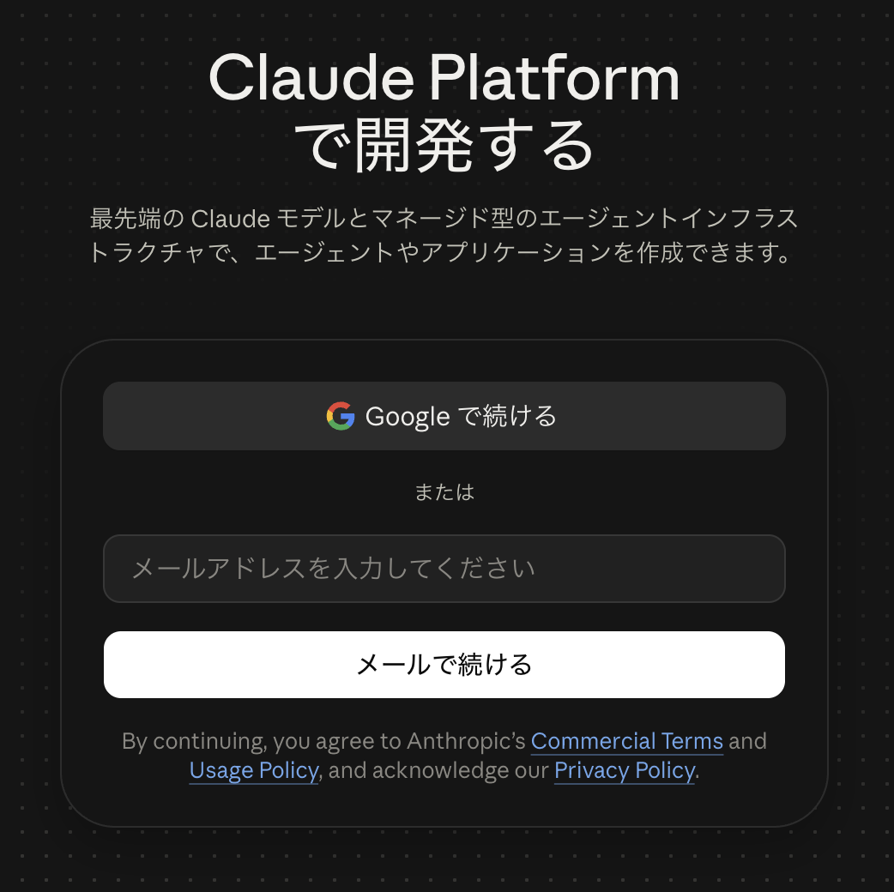

---

<style scoped>
/* 3 枚の画面を、たどる順に横に並べる */
section > p:has(> img) {
  display: flex;
  align-items: center;
  justify-content: center;
  gap: 20px;
  font-size: 40px;
  color: var(--orange);
  margin-top: 8px;
}
section > p:has(> img) img { height: 400px; border-radius: 12px; }
</style>

# 2. Check your organization ID (old UI only)

- Open **Settings → Organization** and copy the **Organization ID**

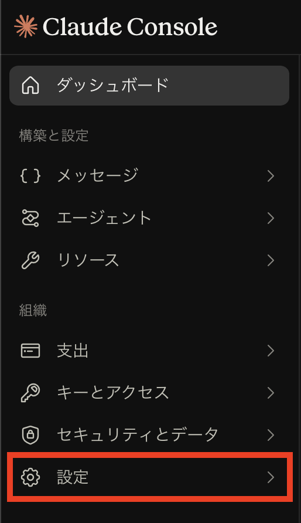 → 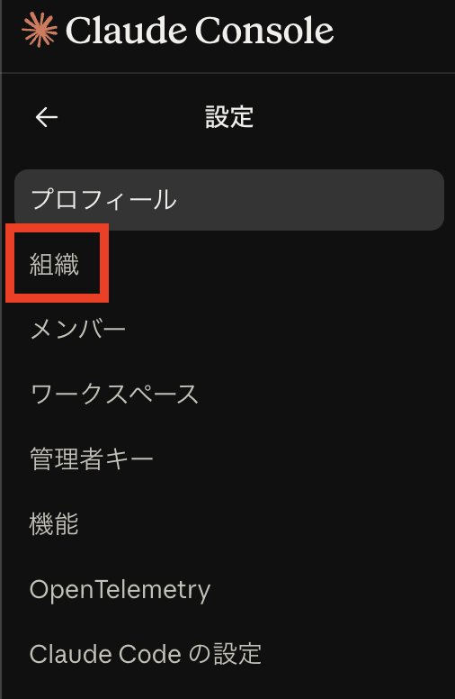 → 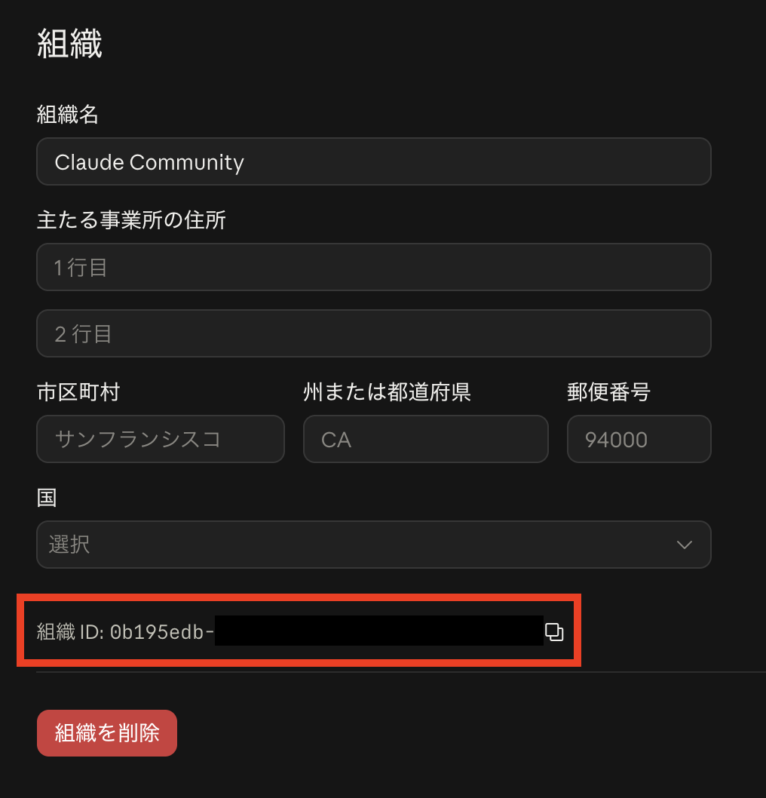

---

<style scoped>
/* 申請のフォームはほぼ正方形なので、右に縦長の枠をとる */
section { padding-right: 600px; font-size: 24px; }
section > p:has(> img) {
  position: absolute;
  right: 64px;
  top: 64px;
  width: 500px;
  margin: 0;
}
section > p:has(> img) img { width: 100%; display: block; border-radius: 16px; }
</style>

# 3. Claim the credits

- Open the claim page from the **QR code** handed out at the venue
- Check that "Claiming as ..." shows **the email address you registered on Luma**
- Enter your name and the products you use, then **submit**
- **$50** in API credits will be added, usually within **a few minutes**
- **Watch out for fraud detection! One claim per person.** Claims from multiple accounts get blocked, and mistakes cannot be fixed

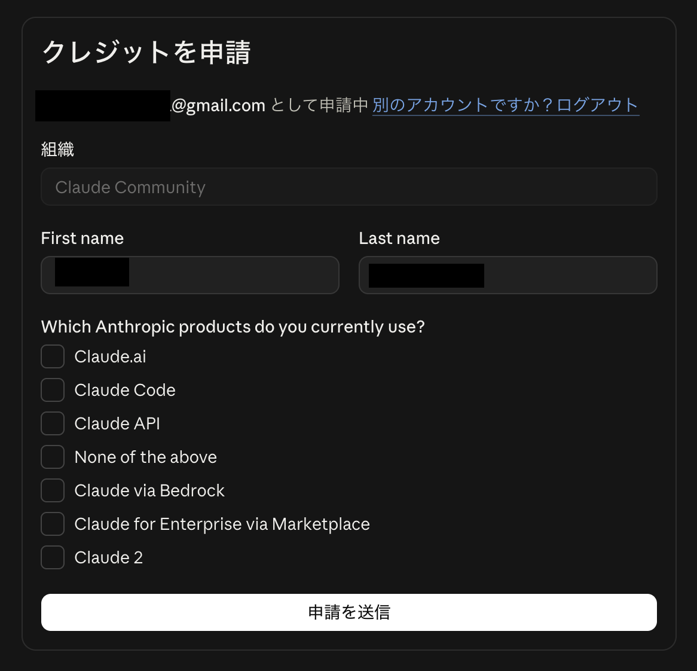

---

<style scoped>
/* 3 枚の画面を、たどる順に横に並べる。大きさがばらばらなので、幅は画像ごとに指定する */
section > p:has(> img) {
  display: flex;
  align-items: center;
  justify-content: center;
  gap: 20px;
  font-size: 40px;
  color: var(--orange);
  margin-top: 8px;
}
section > p:has(> img) img { border-radius: 12px; }
</style>

# 4. Create an API key (1/2)

- Open **API keys** and click **Create key**
- If you are asked about identity federation, choose **Continue with API key**

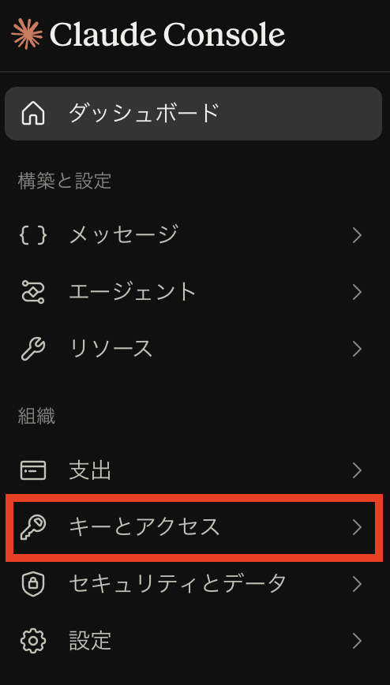 → 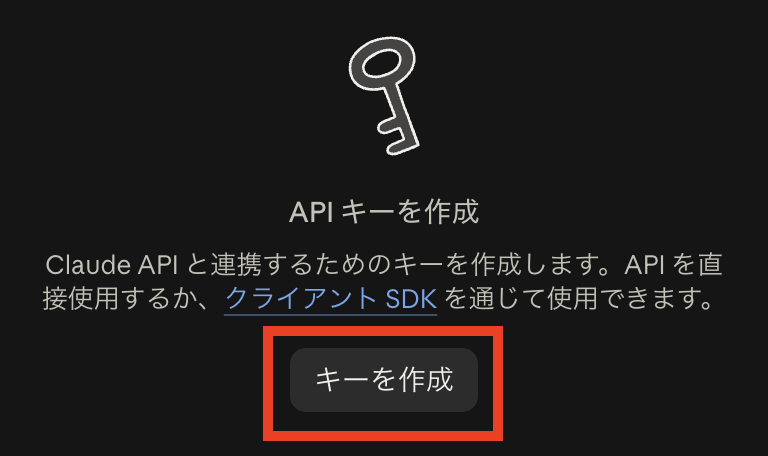 → 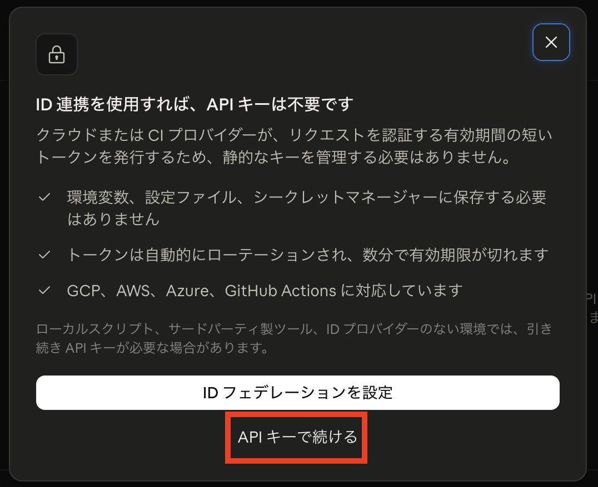

---

<style scoped>
/* ダイアログはほぼ正方形なので、右に縦長の枠をとる */
section { padding-right: 600px; font-size: 24px; }
section > p:has(> img) {
  position: absolute;
  right: 64px;
  top: 64px;
  width: 500px;
  margin: 0;
}
section > p:has(> img) img { width: 100%; display: block; border-radius: 16px; }
</style>

# 4. Create an API key (2/2)

- **Name**: anything
- **Expiration**: **30 days** is recommended
- **Linked account** and **scope**: keep the defaults
- Click **Create key**
- **The key is shown only once.** Copy it right away

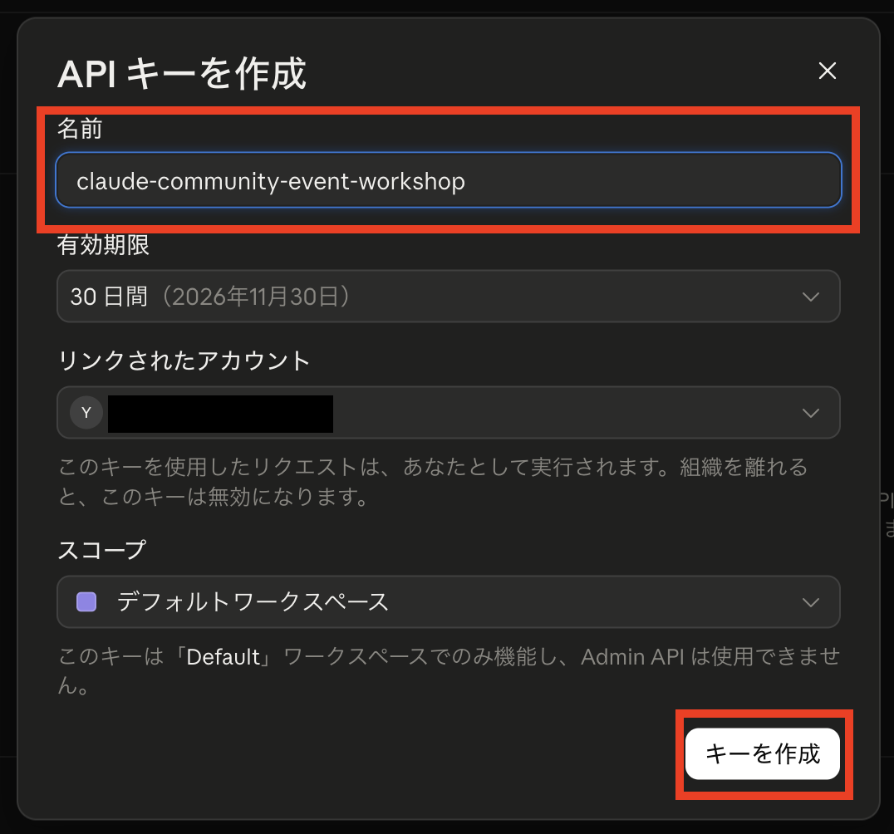

---

<style scoped>
/* 作成画面はほぼ正方形なので、右に縦長の枠をとる。見出しは折り返さないように全幅にし、画面はその下に置く */
section { padding-right: 600px; font-size: 24px; }
section h1 { width: 1152px; }
section > p:has(> img) {
  position: absolute;
  right: 64px;
  top: 160px;
  width: 500px;
  margin: 0;
}
section > p:has(> img) img { width: 100%; display: block; border-radius: 16px; }
</style>

# Optional: Set the key in GitHub Codespaces

- Use **Google Chrome**. Safari has issues
- Click 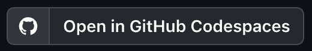 in the [repository](https://github.com/hayatoshibahara/claude-agent-workshop)
- Paste the API key from step 4 into **ANTHROPIC_API_KEY**
- Click **Create codespace**

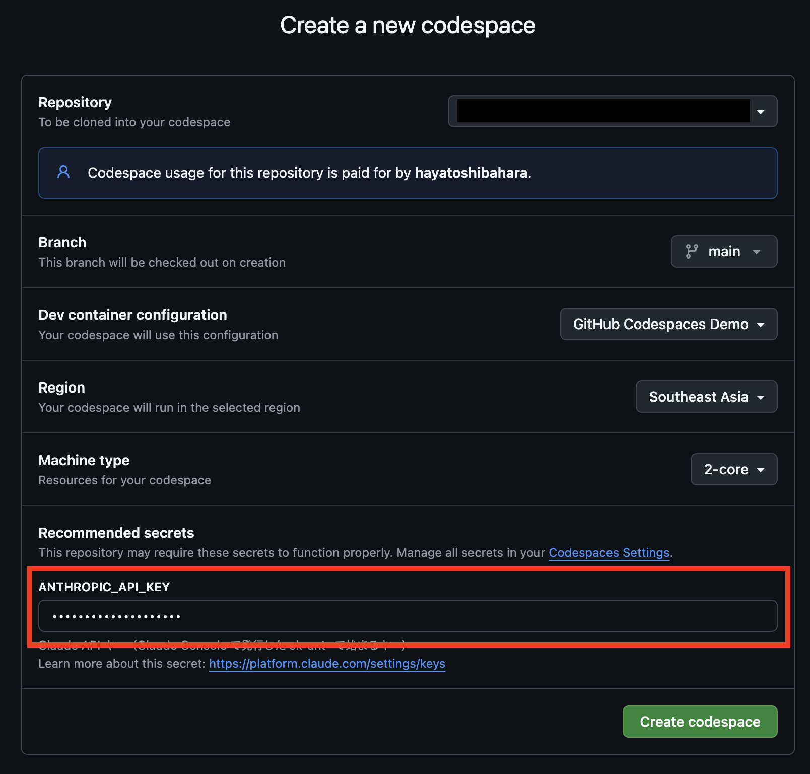

---

<!-- _class: flow -->

# Optional: Set the key in Claude Desktop (1/3)

- **Log out** of Claude Desktop
- **Help → Troubleshooting → Enable Developer Mode**

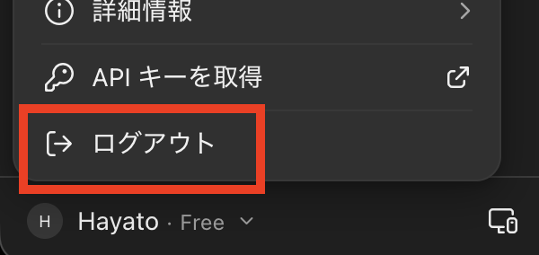 → 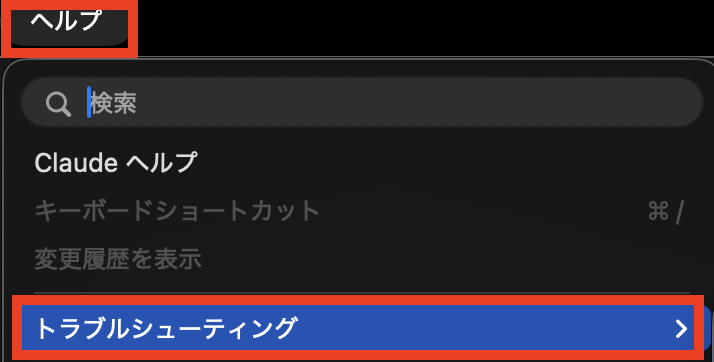

---

<!-- _class: flow -->

# Optional: Set the key in Claude Desktop (2/3)

- **Developer → Configure third-party inference…**
- Choose **Claude API** and paste the key from step 4 into **Claude API key**
- Check it with **Test connection**

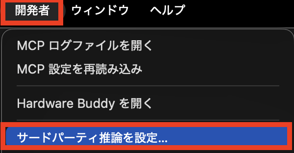 → 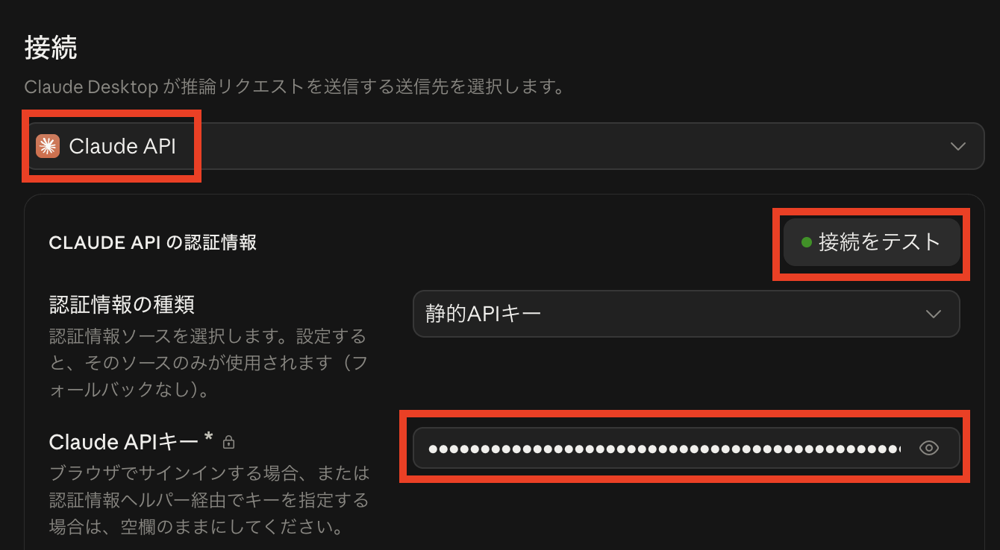

---

<!-- _class: flow -->

# Optional: Set the key in Claude Desktop (3/3)

- On the sign-in screen, choose **Or sign in with Claude API**
- Click **Continue** (usage is billed to your API organization in the Claude Console)

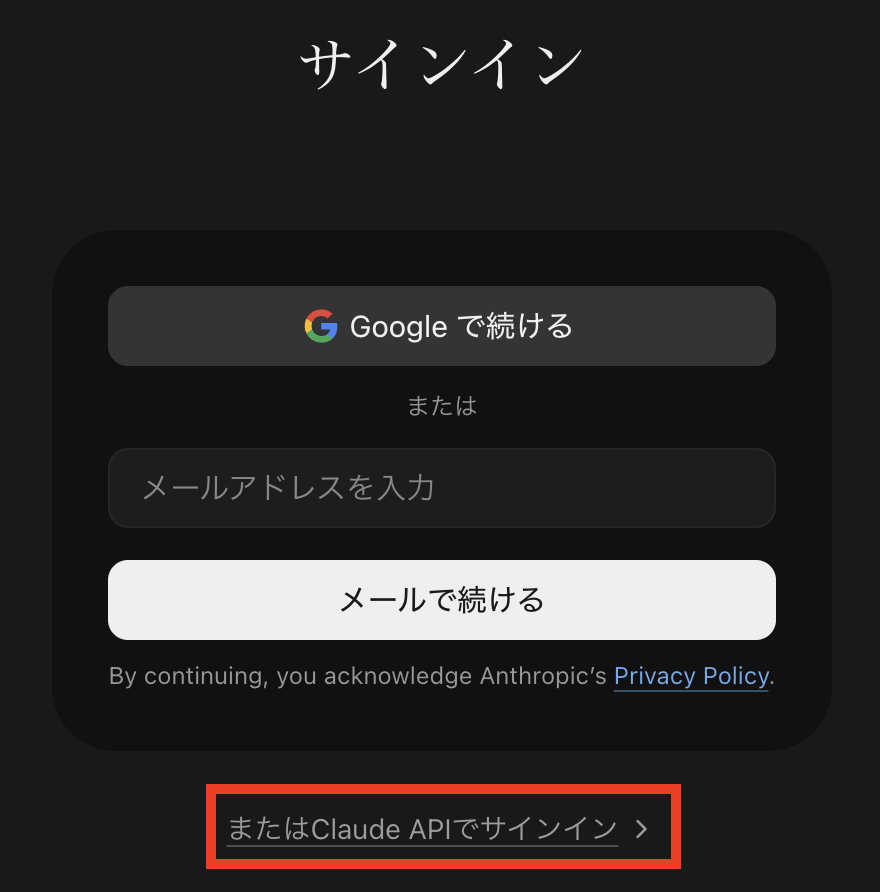 → 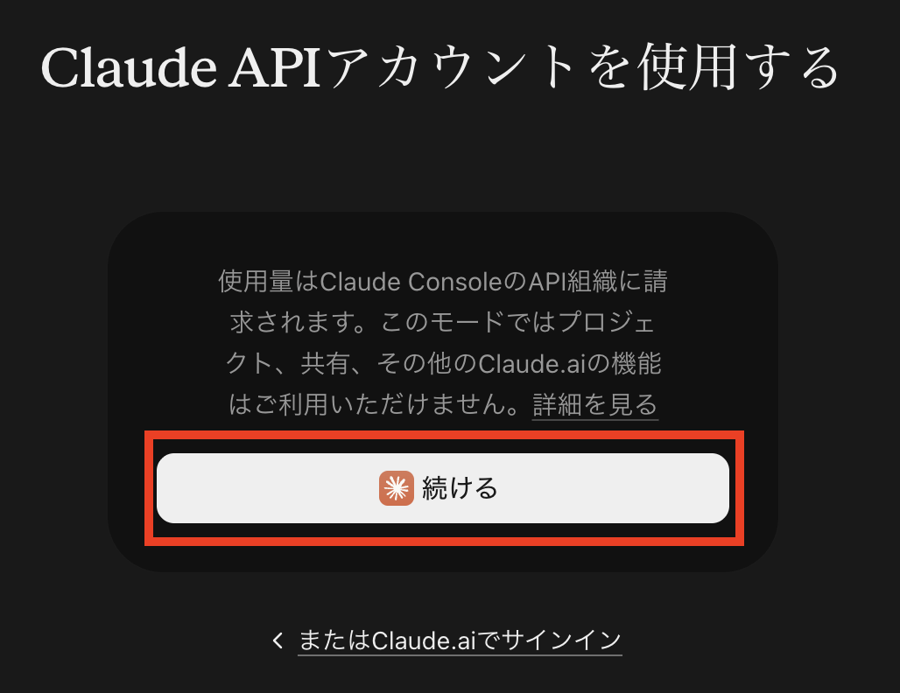

---

<style scoped>
pre { font-size: 28px; margin: 8px 0 32px; }
</style>

# Optional: Set the key in Claude Code

Set the key as an environment variable in the terminal, then start Claude Code

```bash
export ANTHROPIC_API_KEY=sk-ant-...
claude
```

To undo

```bash
unset ANTHROPIC_API_KEY
```

---

<!-- _class: divider -->

Hands-on

# Claude Agent hands-on

---

<style scoped>
ul { font-size: 26px; line-height: 1.5; }
h1 + p { font-size: 32px; margin-bottom: 20px; }
</style>

# What is a Claude Agent?

**An AI agent that runs on the same machinery as Claude Code**

- Not just for coding: **it works for general tasks**
  - Deep research on AI news from around the world
  - Producing and posting short videos
  - Machine learning experiments
- It uses files, commands, and web search to **get the work done on its own**
- Two ways to build one
  - **Claude Managed Agents**: runs on Anthropic's cloud (API only)
  - **Claude Agent SDK**: runs anywhere (also works with a subscription)

---

<style scoped>
/* 左に流れの図、右に Instagram の画面と、成果（ダッシュボード）を並べる。画像は alt で選ぶ */
img[alt="flow"] { position: absolute; left: 100px; top: 146px; height: 450px; }
img[alt="instagram"], img[alt="dashboard"] { position: absolute; top: 160px; height: 430px; border-radius: 14px; }
img[alt="instagram"] { right: 297px; }
img[alt="dashboard"] { right: 64px; }
.cap { position: absolute; top: 600px; font-size: 16px; text-align: center; }
.cap-instagram { right: 297px; width: 239px; }
.cap-dashboard { right: 64px; width: 209px; font-weight: 600; }
.prompt { position: absolute; left: 116px; top: 606px; font-size: 18px; }
.prompt b { color: var(--orange); }
</style>

# Example: Producing and posting short videos

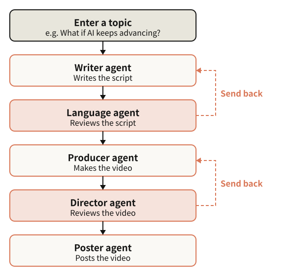
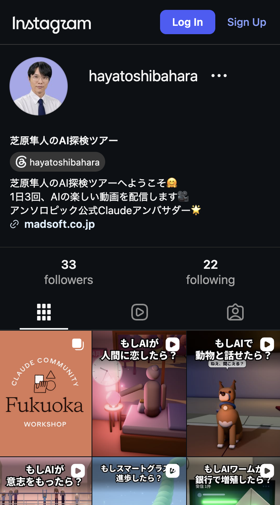
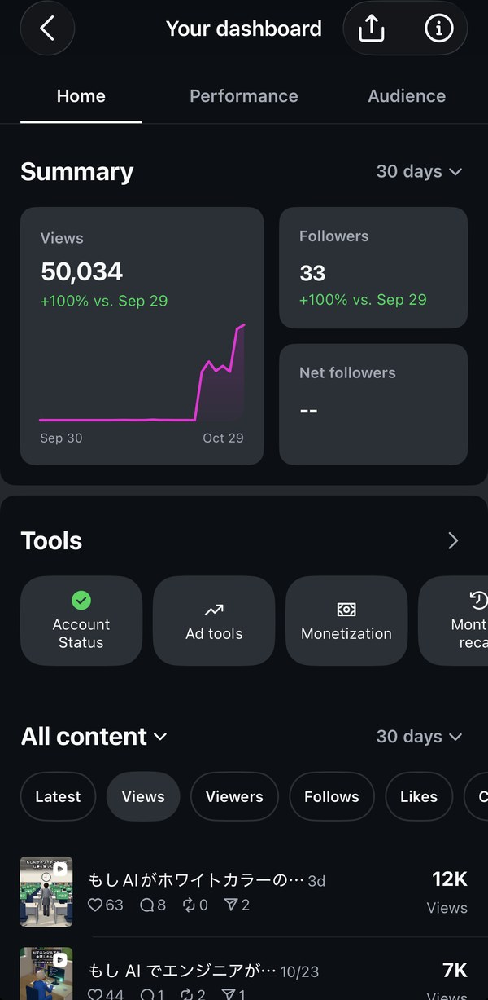

<div class="cap cap-instagram"><a href="https://instagram.com/hayatoshibahara">instagram.com/hayatoshibahara</a></div>
<div class="cap cap-dashboard">50K views in 6 days</div>
<div class="prompt"><b>Prompt: </b>I want to make videos with the Claude Agent SDK</div>

---

<style scoped>
ul { font-size: 26px; line-height: 1.5; }
h1 + p { font-size: 32px; margin-bottom: 20px; }
</style>

# Claude Managed Agents

**Build and run agents on Anthropic's cloud, right from the browser**

- Describe it, and it sets up **multiple agents that split the work**
- **Connect to external services** such as Slack, Notion, and GitHub
- **Scheduled runs**, with a **webhook** when done
- Good for **long tasks** (data stored in the US; no zero data retention)
  - Reviewing a stack of uploaded contracts
  - Matching ledgers against invoices and receipts
  - Hunting bugs across a whole repository
- API usage + $0.08/hour (Max: $100/month, Ultra: $200/month in API credits)
- Small compute: up to 8 GB memory, 10 GB disk, no GPU

---

<!-- _class: flow -->

<style scoped>
blockquote { margin: 8px 0 24px; padding: 12px 20px; border-left: 6px solid var(--orange); background: var(--card); border-radius: 0 12px 12px 0; font-size: 24px; }
blockquote p { margin: 0; }
.quick { font-size: 16px; margin: -8px 0 16px; }
</style>

# Try Claude Managed Agents

- In the [Claude Console](https://platform.claude.com), open **Agents → Create**
- In "What do you want to build?", describe the agent and send it

> An agent that finds data in Fukuoka City Open Data ([https://odcs.bodik.jp/401307/](https://odcs.bodik.jp/401307/)) and creates chart images

<div class="quick">* Short on time? Send "A minimal agent that gets the weather from Open-Meteo" instead</div>

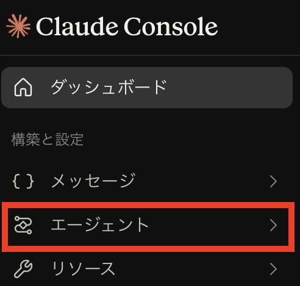 → 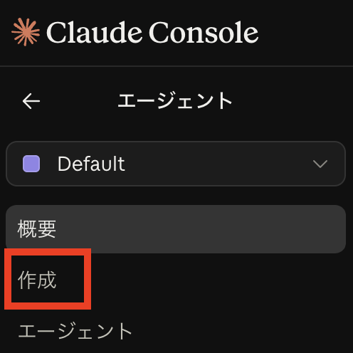 → 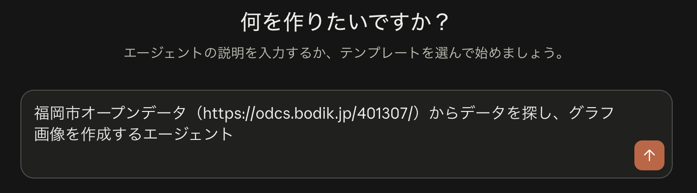

---

<style scoped>
/* 左にネットワークの選択、右に結果の画面。画像は alt で選ぶ */
img[alt="network"] { position: absolute; left: 64px; top: 230px; width: 540px; border-radius: 12px; }
img[alt="result"] { position: absolute; right: 64px; top: 200px; width: 560px; border-radius: 12px; }
.cap { position: absolute; font-size: 18px; }
.cap-network { left: 64px; top: 410px; width: 540px; }
.cap-result { right: 64px; top: 600px; width: 560px; }
h1 + p { font-size: 20px; }
</style>

# Start a session and give it a task

**Create agent → Configure environment → Create new environment → Unrestricted → Start session**

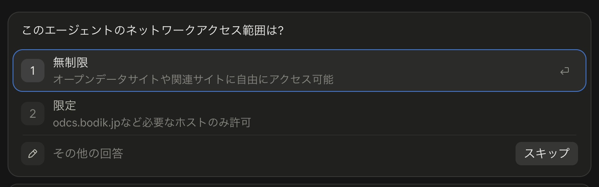
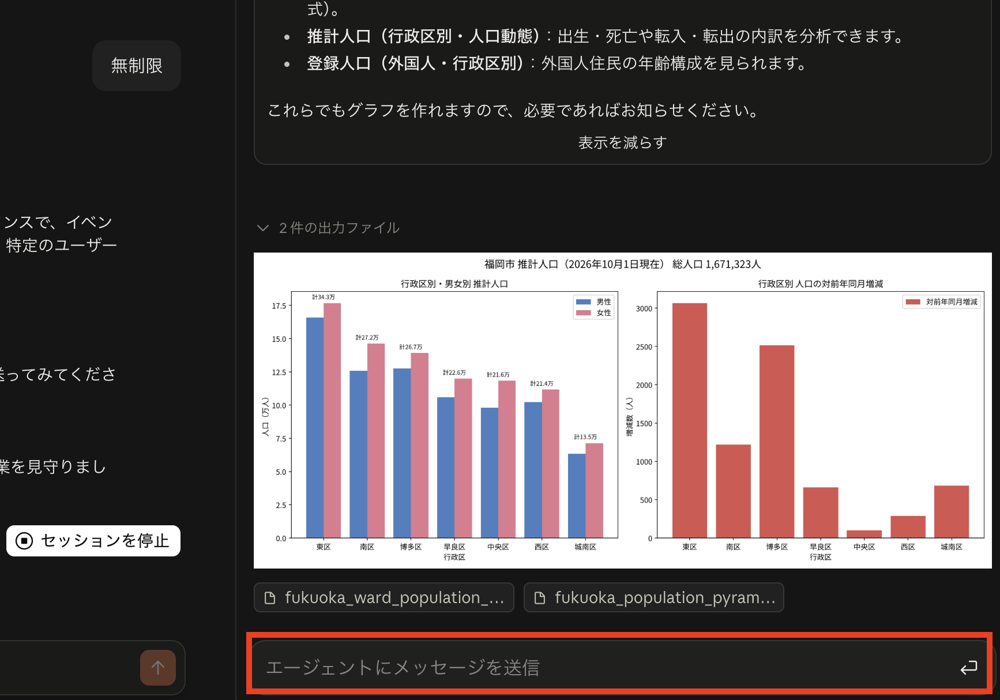

<div class="cap cap-network">For simplicity, give the environment unrestricted network access</div>
<div class="cap cap-result">Send a message, and the agent carries out the task<br>To connect services, ask e.g. "Connect to Google Drive"</div>

---

<style scoped>
ul { font-size: 26px; line-height: 1.5; }
h1 + p { font-size: 32px; margin-bottom: 20px; }
</style>

# Claude Agent SDK

**Embed Claude Code as a building block in your own app**

- Run **the same agent as Claude Code** from Python or TypeScript
  - File operations, commands, web search, MCP, Skills, and subagents all included
- **Runs wherever you like**: your PC, a server, GitHub Codespaces, and more
- Compute **depends on the machine you run it on**. It can run on GPU machines too
- **Works with a subscription**. Use an API key for apps you share with others
- You pay only for API usage. Max and Ultra API credits also work

---

<!-- _class: flow -->

# Try the Claude Agent SDK (1/4)

- Use **Google Chrome**. Safari has issues
- Go to [github.com/hayatoshibahara/claude-agent-workshop](https://github.com/hayatoshibahara/claude-agent-workshop)
- Click **Open in GitHub Codespaces**
- Choose **Trust Folder & Continue**
- Choose **Claude Code** at the top right

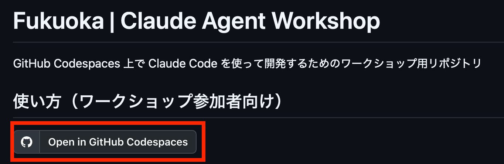 → 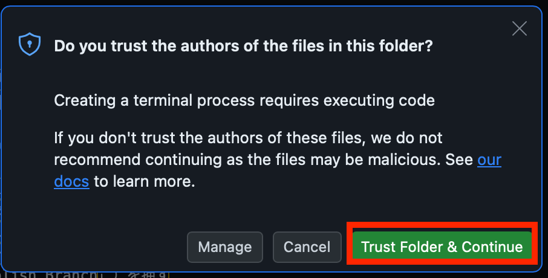 → 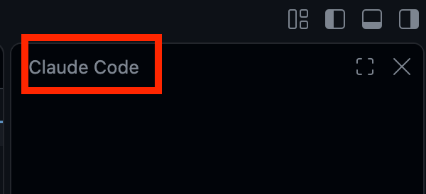

---

<style scoped>
blockquote { margin: 8px 0 24px; padding: 12px 20px; border-left: 6px solid var(--orange); background: var(--card); border-radius: 0 12px 12px 0; font-size: 24px; }
blockquote p { margin: 0; }
img[alt="prompt"] { position: absolute; left: 64px; top: 400px; width: 480px; border-radius: 12px; }
.quick { font-size: 16px; margin-top: -8px; }
img[alt="reload"] { position: absolute; right: 64px; top: 410px; width: 580px; border-radius: 12px; }
.cap-reload { position: absolute; right: 64px; top: 510px; width: 580px; font-size: 18px; }
</style>

# Try the Claude Agent SDK (2/4)

- Send this to Claude Code

> Use the Claude Agent SDK to build an interactive web app for this agent: an agent that finds data in Fukuoka City Open Data ([https://odcs.bodik.jp/401307/](https://odcs.bodik.jp/401307/)) and creates chart images

<div class="quick">* Short on time? Send "Use the Claude Agent SDK to build a minimal web app that gets the weather from Open-Meteo" instead</div>

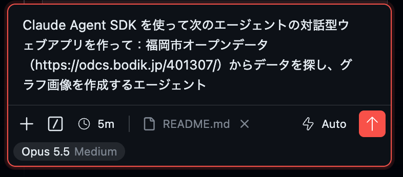
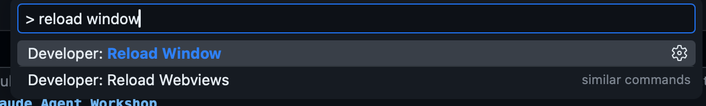

<div class="cap-reload">If Visual Studio Code looks broken, reload it<br>Press Ctrl or ⌘ + Shift + P and type "reload window"</div>

---

<style scoped>
/* 左に手順と画面を上から順に、右に完成したアプリの画面 */
section { padding-right: 680px; }
section h1 { width: 1152px; margin-bottom: 20px; }
section > p { margin: 0 0 8px; font-size: 22px; }
section > p:has(> img) { margin: 0 0 12px; }
section > p:has(> img) img { border-radius: 10px; display: block; margin-bottom: 6px; }
img[alt="app"] { position: absolute; right: 64px; top: 160px; width: 600px; border-radius: 12px; margin: 0; }
.cap-app { position: absolute; right: 64px; top: 580px; width: 600px; font-size: 20px; font-weight: 600; }
</style>

# Try the Claude Agent SDK (3/4)

**1.** When it is done, type "Start it"

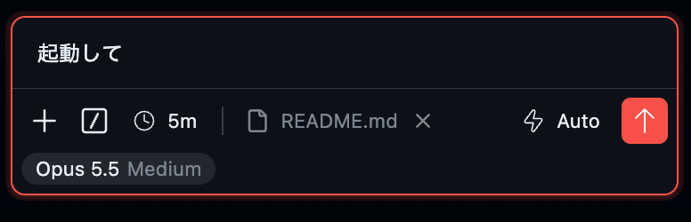

**2.** Choose **Ports** → **Open in Browser**

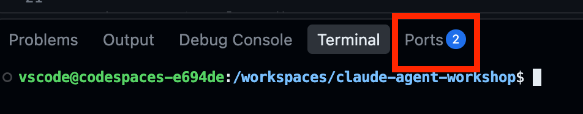
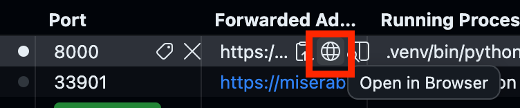

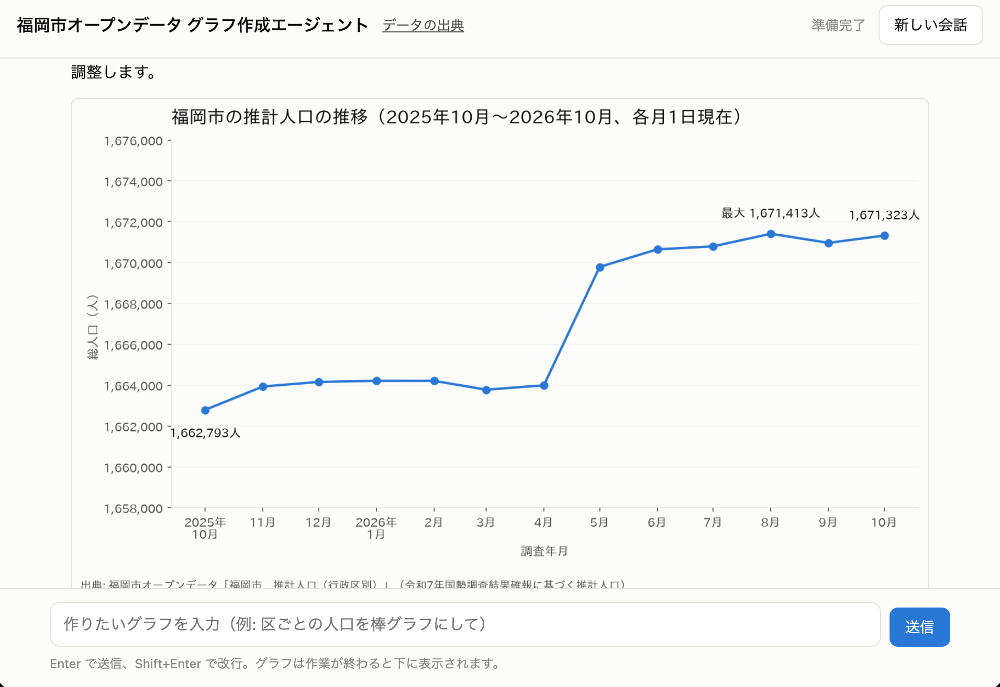

<div class="cap-app">The app starts, and your interactive app is ready</div>

---

<style scoped>
blockquote { margin: 8px 0 20px; padding: 12px 20px; border-left: 6px solid var(--orange); background: var(--card); border-radius: 0 12px 12px 0; font-size: 26px; }
blockquote p { margin: 0; }
/* 左に保存の指示の画面、右に Delete の画面 */
img[alt="save"] { position: absolute; left: 64px; top: 400px; width: 560px; border-radius: 12px; }
img[alt="delete"] { position: absolute; right: 64px; top: 360px; width: 520px; border-radius: 12px; }
</style>

# Try the Claude Agent SDK (4/4)

- Ask Claude Code to save the app, too

> Save the app to my own repository on GitHub

- When you are done, go to [github.com/codespaces](https://github.com/codespaces) and choose **…** → **Delete** on your codespace

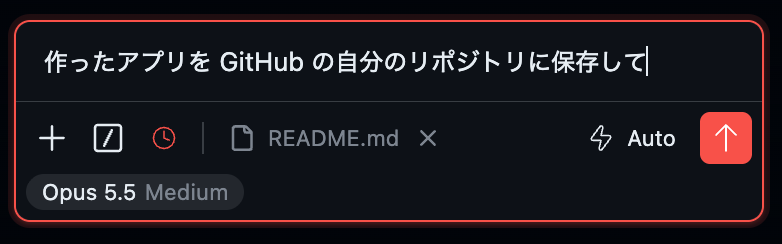
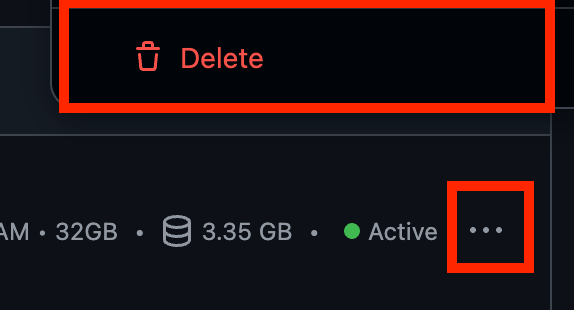

---

<style scoped>
pre { font-size: 15px; line-height: 1.4; margin: 0; padding: 16px 22px; }
section { padding-right: 420px; }
.note { position: absolute; right: 64px; top: 180px; width: 330px; font-size: 22px; line-height: 1.6; }
.note p { margin: 0 0 20px; }
.note b { color: var(--orange); }
</style>

# The Claude Agent SDK is simple

```python
import asyncio
from claude_agent_sdk import AgentDefinition, ClaudeAgentOptions, query

# Configure the agent
options = ClaudeAgentOptions(
    system_prompt="Make charts from Fukuoka City Open Data",
    allowed_tools=["WebFetch", "Bash", "Write"],
    permission_mode="acceptEdits",
    # Subagent (a helper with its own context)
    agents={"finder": AgentDefinition(
        description="Finds data",
        prompt="Find usable data in Fukuoka City Open Data",
        tools=["WebFetch"],
    )},
)

# Send a task and receive progress as it streams in
async def main():
    async for message in query(prompt="Chart the population trend", options=options):
        print(message)

asyncio.run(main())
```

<div class="note">

<b>options</b><br>Agent settings: its role, the tools it may use, and what it can do without asking

<b>agents</b><br>Subagents. Split the work with separate roles, prompts, and tools

<b>query</b><br>Send a task, and the agent uses tools on its own to get it done. Messages stream in as it works

</div>

---

<style scoped>
table { font-size: 20px; line-height: 1.4; }
th, td { padding: 8px 14px 8px 0; }
td:last-child { color: var(--orange); }
</style>

# Going further

| Feature | What it does | What to tell Claude Code (example) |
| --- | --- | --- |
| Tools and permissions | Choose the tools and what runs without asking | "Only use WebFetch, Bash, and Write" |
| MCP | Connect to external services | "Integrate with the Google Workspace MCP" |
| Hooks | Run your own code before and after tool calls | "Write the agent's action history to a log" |
| Subagents | Hand work off to helpers, even in parallel | "Translate the documents with 20 in parallel" |
| Skills | Load a playbook (SKILL.md) only when needed | "Use the yomiyasu skill to make the Japanese easier to read" |
| Structured output | Return answers in a fixed JSON shape | "Return the title and image path as JSON" |
| Limits | Stop by number of turns and cost | "Use at most 5 turns and $1" |

---

<style scoped>
img[alt="figure"] { position: absolute; left: 64px; top: 140px; height: 500px; }
section { padding-left: 660px; }
section h1 { margin-left: -596px; }
ul { font-size: 22px; line-height: 1.55; }
</style>

# Single harness

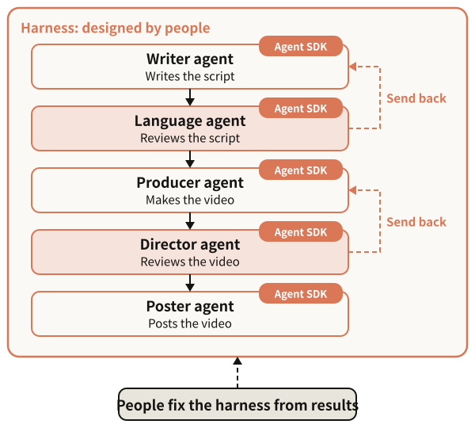

- The agent works inside **a harness designed by people**
- One agent is fine, and so are **several in a row**
- You can add a reviewer that **sends work back** when it falls short
- **People** fix the harness: they look at the results and rewrite prompts and steps
- Examples: Claude Code, SWE-agent, MetaGPT, ChatDev, The AI Scientist, the short video example

---

<style scoped>
img[alt="figure"] { position: absolute; left: 64px; top: 140px; height: 500px; }
section { padding-left: 660px; }
section h1 { margin-left: -596px; }
ul { font-size: 22px; line-height: 1.55; }
</style>

# Double harness

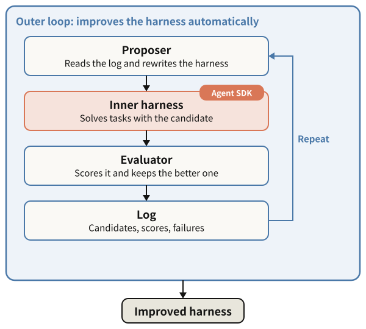

- **An outer loop** rewrites and improves the harness itself
- A proposer rewrites it → the inner harness solves tasks → an evaluator keeps it if it is better
- Instead of people fixing it, **it improves automatically by watching the scores**
- **Caution**: don't start with a complex harness. Get a single harness working and decide how to evaluate first
- Examples: Meta-Harness, AHE, OO-Harness, ADAS, AFlow, Darwin Gödel Machine, DSPy, GEPA

---

<!-- _class: divider -->

<style scoped>
.sns { display: grid; grid-template-columns: 28px auto; gap: 10px 14px; align-items: center; justify-content: center; font-size: 24px; margin-top: 36px; }
.sns svg { width: 28px; height: 28px; display: block; }
</style>

Your Turn

# Build your Claude Agent

<div class="sns">
<svg viewBox="0 0 24 24" aria-hidden="true"><path fill="currentColor" d="M12 3v10.55A4 4 0 1 0 14 17V7h4V3h-6z"/></svg><a href="https://www.youtube.com/watch?v=tRsQsTMvPNg">Claude FM　youtube.com/watch?v=tRsQsTMvPNg</a>
</div>

---

<!-- _class: divider -->

<style scoped>
.note { font: 400 24px/1.5 var(--sans); margin-top: 36px; }
</style>

Let's Share

# Share your Claude Agent

<div class="note">Let us know if you'd rather not appear in social media posts</div>

---

<style scoped>
section h1 { margin-bottom: 20px; }
.events { display: grid; grid-template-rows: 1fr 1fr; gap: 20px; }
.follow { margin-top: 20px; font-size: 22px; line-height: 1.5; }
.follow b { color: var(--orange); }
.event { display: grid; grid-template-columns: 180px 1fr; gap: 32px; align-items: center; }
.event img { width: 180px; height: 180px; border-radius: 12px; }
.event h2 { font-size: 32px; margin: 0 0 10px; line-height: 1.3; }
.event dl { margin: 0; font-size: 22px; line-height: 1.5; display: grid; grid-template-columns: auto 1fr; column-gap: 16px; row-gap: 4px; }
.event dt { font-weight: 600; color: var(--orange); }
.event dd { margin: 0; }
</style>

# Upcoming events

<div class="events">
<div class="event">
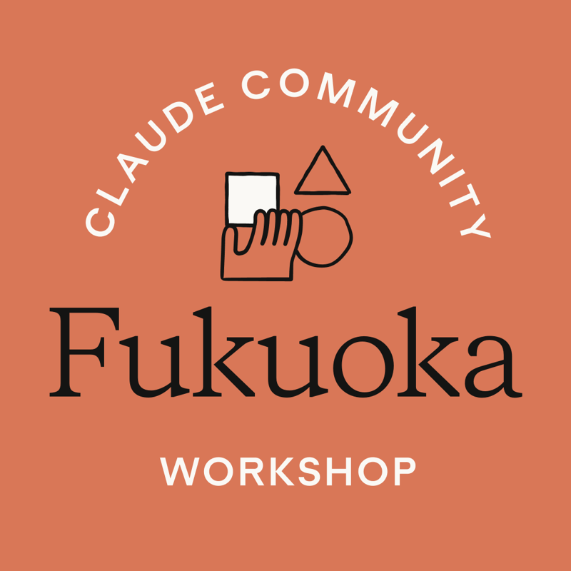
<div>
<h2>Claude Workshop For Beginners</h2>
<dl>
<dt>When</dt><dd>Mon, Nov 23 (holiday), 16:00–19:00</dd>
<dt>Where</dt><dd>Garraway F (Imaizumi, Chuo-ku, Fukuoka)</dd>
<dt>For</dt><dd>First-time Claude users, and Claude community builders</dd>
<dt>URL</dt><dd><a href="https://luma.com/claude-zu7g">luma.com/claude-zu7g</a></dd>
</dl>
</div>
</div>
<div class="event">
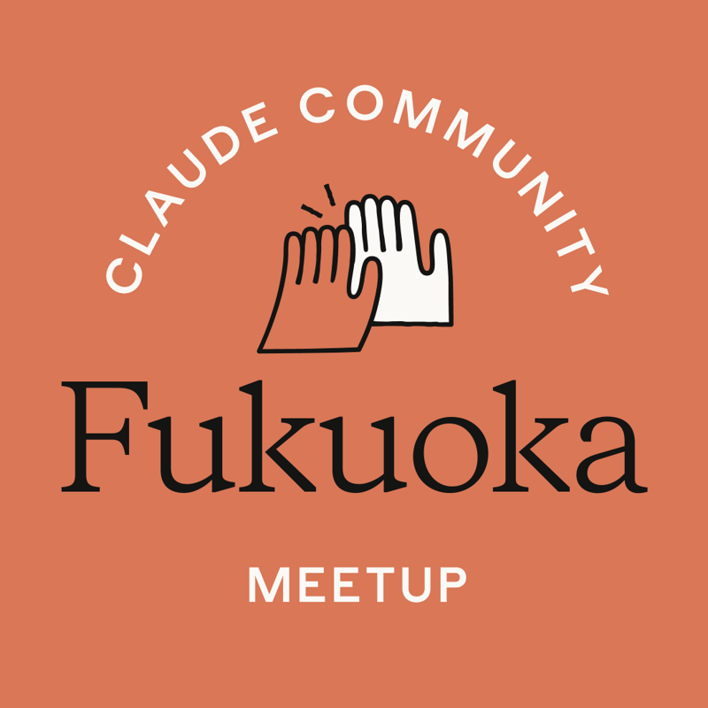
<div>
<h2>Claude Meetup</h2>
<dl>
<dt>When</dt><dd>Sun, Nov 29, 16:00–19:00</dd>
<dt>Where</dt><dd>Around Tenjin</dd>
<dt>For</dt><dd>Swapping tips on using Claude, personally or at work. Speakers wanted</dd>
<dt>URL</dt><dd><a href="https://luma.com/claude-ah22">luma.com/claude-ah22</a></dd>
</dl>
</div>
</div>
</div>

<div class="follow">

- For the latest news, follow <a href="https://madsoft.co.jp/qr-code"><b>Hayato Shibahara on social media</b></a>
- We're looking for people to co-host events with us

</div>

---

<!-- _class: opener -->
<!-- _paginate: false -->

