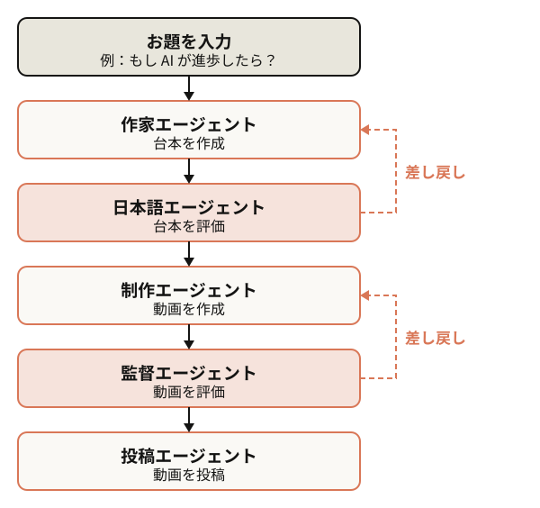
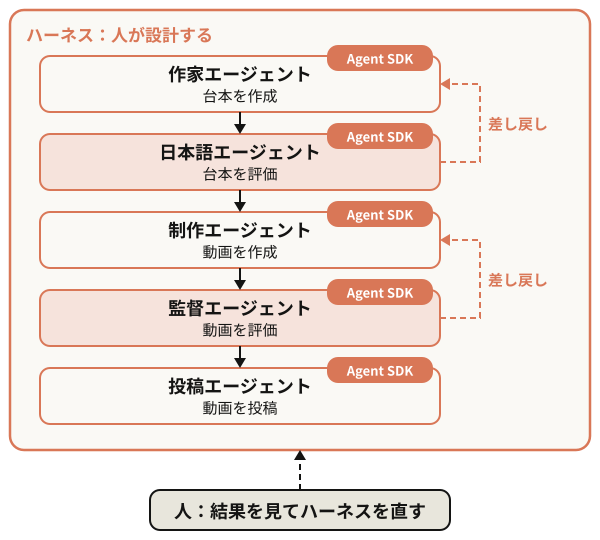
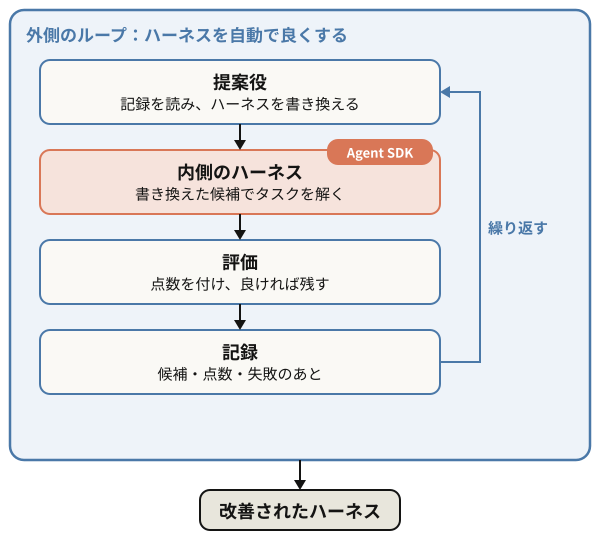

<!-- _class: cover -->
<!-- _paginate: false -->

<style scoped>
.fm { position: absolute; right: 64px; top: 621px; color: var(--ivory); display: flex; align-items: center; gap: 10px; font: 400 20px/1 var(--sans); }
.fm svg { width: 24px; height: 24px; }
.fm a { color: var(--ivory); text-decoration: none; }
</style>

Claude Community<br>Fukuoka | Claude Agent Workshop

<div class="fm"><svg viewBox="0 0 24 24" aria-hidden="true"><path fill="currentColor" d="M12 3v10.55A4 4 0 1 0 14 17V7h4V3h-6z"/></svg><a href="https://www.youtube.com/watch?v=tRsQsTMvPNg">Claude FM　youtube.com/watch?v=tRsQsTMvPNg</a></div>

November 1, 2026　Hayato Shibahara

---

<!-- _class: agenda -->

# Timeline

- オープニング
- セットアップ
- Claude Agent ハンズオン
  - Claude Agent の概要
  - Claude Managed Agents
  - Claude Agent SDK
  - ハーネスエンジニアリング
- Claude Agent を作ろう
- Claude Agent を共有しよう
- クロージング
- 懇親会

---

<!-- _class: split -->

<style scoped>
/* テンプレートの About the host に合わせて写真を上に寄せる。正方形の写真は切らずに収め、枠を写真の背景の色で塗る。
   肩書きが折り返さないように、枠を細くして左の列を広げる */
section { padding-right: 664px; }
.sns { display: grid; grid-template-columns: 28px 1fr; gap: 10px 14px; align-items: center; font-size: 20px; margin-top: 8px; }
.sns img { width: 26px; height: 26px; display: block; }
section > p:has(> img) { top: 86px; left: 696px; width: 520px; height: 520px; background: #a5a8eb; }
section > p:has(> img) img { object-fit: contain; }
</style>

# About the host

**芝原 隼人**

- マッドソフト株式会社代表
- エンジニアカフェコミュニティマネージャー
- Claude コミュニティアンバサダー

<div class="sns">
<a href="https://x.com/hayatoshibahara">hayatoshibahara</a>
<a href="https://www.instagram.com/hayatoshibahara">hayatoshibahara</a>
<a href="https://www.facebook.com/hayatoshibahara">hayatoshibahara</a>
<a href="https://www.linkedin.com/in/hayato-shibahara-b9592637">hayato-shibahara-b9592637</a>
</div>


---

<style scoped>
p.post { margin: 12px 0 40px; font: 600 38px/1.3 var(--sans); }
p.post a { color: var(--orange); text-decoration: none; }
ul { font-size: 28px; line-height: 1.6; }
section { padding-right: 460px; }
img[alt="qr"] { position: absolute; right: 64px; top: 160px; width: 340px; padding: 20px; background: #fff; border-radius: 16px; }
</style>

# Share on SNS

SNS 投稿のハッシュタグは、次の 2 つを使ってください

<p class="post"><a href="https://x.com/intent/tweet?text=%23ClaudeCommunityEvent%20%23ClaudeCommunityEventFukuoka">#ClaudeCommunityEvent</a><br><a href="https://x.com/intent/tweet?text=%23ClaudeCommunityEvent%20%23ClaudeCommunityEventFukuoka">#ClaudeCommunityEventFukuoka</a></p>


- 写真・動画の投稿は大歓迎です！盛り上げてください
- 参加者と登壇者には配慮してください

---

<!-- _class: divider -->

Setup

# セットアップ

---

<style scoped>
ol, ul { font-size: 32px; line-height: 1.6; margin: 16px 0 0; }
</style>

# Anthropic API キーを用意する

ワークショップでは、特典のクレジットで Claude の API を使う

1. サインイン
2. 組織 ID を確認（新UIでは不要）
3. 特典を申請
4. API キーを作成

---

<!-- _class: split wide -->

# 1. サインイン

- **[platform.claude.com](https://platform.claude.com)** を開く
- **Luma に登録したメールアドレス**を使用


---

<style scoped>
/* 3 枚の画面を、たどる順に横に並べる */
section > p:has(> img) {
  display: flex;
  align-items: center;
  justify-content: center;
  gap: 20px;
  font-size: 40px;
  color: var(--orange);
  margin-top: 8px;
}
section > p:has(> img) img { height: 400px; border-radius: 12px; }
</style>

# 2. 組織を作成・確認（旧UIでは、組織IDも必要）

- **設定 → 組織** で組織名・住所を入力する（旧UIでは**組織 ID** もコピー）

 →  → 

---

<style scoped>
/* 申請のフォームはほぼ正方形なので、右に縦長の枠をとる */
section { padding-right: 600px; font-size: 24px; }
section > p:has(> img) {
  position: absolute;
  right: 64px;
  top: 64px;
  width: 500px;
  margin: 0;
}
section > p:has(> img) img { width: 100%; display: block; border-radius: 16px; }
</style>

# 3. 特典を申請

- 会場で配る **QR コード**から、特典のページを開く
- 「○○ として申請中」が **Luma に登録したメールアドレス**かを確かめる
- 名前と、使っている製品を入れて**申請を送信**
- **$50** の API クレジットが入る。通常はすぐ〜**数分**
- **不正検知に注意！1 人 1 回だけ。** 複数のアカウントから申請すると、不正の検知で止められる。間違えても直してもらえない


---

<style scoped>
/* 3 枚の画面を、たどる順に横に並べる。大きさがばらばらなので、幅は画像ごとに指定する */
section > p:has(> img) {
  display: flex;
  align-items: center;
  justify-content: center;
  gap: 20px;
  font-size: 40px;
  color: var(--orange);
  margin-top: 8px;
}
section > p:has(> img) img { border-radius: 12px; }
</style>

# 4. API キーを作成（1/2）

- **キーとアクセス** を開き、**キーを作成** を押す
- ID 連携の案内が出たら、**API キーで続ける**

 →  → 

---

<style scoped>
/* ダイアログはほぼ正方形なので、右に縦長の枠をとる */
section { padding-right: 600px; font-size: 24px; }
section > p:has(> img) {
  position: absolute;
  right: 64px;
  top: 64px;
  width: 500px;
  margin: 0;
}
section > p:has(> img) img { width: 100%; display: block; border-radius: 16px; }
</style>

# 4. API キーを作成（2/2）

- **名前**: 何でもよい
- **有効期限**: **30 日間**がおすすめ
- **リンクされたアカウント**・**スコープ**: そのままでよい
- **キーを作成** を押す
- **キーは 1 回しか表示されない。** すぐにコピーする


---

<style scoped>
/* 作成画面はほぼ正方形なので、右に縦長の枠をとる。見出しは折り返さないように全幅にし、画面はその下に置く */
section { padding-right: 600px; font-size: 24px; }
section h1 { width: 1152px; }
section > p:has(> img) {
  position: absolute;
  right: 64px;
  top: 160px;
  width: 500px;
  margin: 0;
}
section > p:has(> img) img { width: 100%; display: block; border-radius: 16px; }
</style>

# 任意：GitHub Codespaces にキーを設定

- **Google Chrome** で開く。Safari は不具合が出る
- [リポジトリ](https://github.com/hayatoshibahara/claude-agent-workshop)の  を押す
- **ANTHROPIC_API_KEY** に、手順 4 でコピーした API キーを貼る
- **Create codespace** を押す


---

<!-- _class: flow -->

# 任意：Claude Desktop にキーを設定（1/3）

- Claude Desktop から**ログアウト**する
- **ヘルプ → トラブルシューティング → 開発者モードを有効にする**

 → 

---

<!-- _class: flow -->

# 任意：Claude Desktop にキーを設定（2/3）

- **開発者 → サードパーティ推論を設定…**
- **Claude API** を選び、**Claude API キー**に手順 4 のキーを貼る
- **接続をテスト** で確かめる

 → 

---

<!-- _class: flow -->

# 任意：Claude Desktop にキーを設定（3/3）

- サインインの画面で **または Claude API でサインイン**
- **続ける** を押す（使用量は Claude Console の API の組織に請求される）

 → 

---

<style scoped>
pre { font-size: 28px; margin: 8px 0 32px; }
</style>

# 任意：Claude Code にキーを設定

Claude Code を起動するターミナルで、環境変数にキーを入れてから起動する

```bash
export ANTHROPIC_API_KEY=sk-ant-...
claude
```

元に戻すとき

```bash
unset ANTHROPIC_API_KEY
```

---

<!-- _class: divider -->

Hands-on

# Claude Agent ハンズオン

---

<style scoped>
ul { font-size: 26px; line-height: 1.5; }
h1 + p { font-size: 32px; margin-bottom: 20px; }
</style>

# Claude Agent とは？

**Claude Code の仕組みで動く AI エージェント**

- コード生成だけでなく、**汎用的に使える**
  - 各国の AI ニュースのディープリサーチ
  - ショート動画の制作と投稿
  - 機械学習の実験
- ファイル操作・コマンド・ウェブ検索を使って、**自分で仕事を進める**
- 作り方は 2 通り
  - **Claude Managed Agents**：Anthropic のクラウド上で動く（API のみ対応）
  - **Claude Agent SDK**：色々な場所で動く（サブスクリプションにも対応）

---

<style scoped>
/* 左に流れの図、右に Instagram の画面と、成果（ダッシュボード）を並べる。画像は alt で選ぶ */
img[alt="flow"] { position: absolute; left: 100px; top: 146px; height: 450px; }
img[alt="instagram"], img[alt="dashboard"] { position: absolute; top: 160px; height: 430px; border-radius: 14px; }
img[alt="instagram"] { right: 297px; }
img[alt="dashboard"] { right: 64px; }
.cap { position: absolute; top: 600px; font-size: 16px; text-align: center; }
.cap-instagram { right: 297px; width: 239px; }
.cap-dashboard { right: 64px; width: 209px; font-weight: 600; }
.prompt { position: absolute; left: 116px; top: 606px; font-size: 18px; }
.prompt b { color: var(--orange); }
</style>

# 事例：ショート動画の制作と投稿




<div class="cap cap-instagram"><a href="https://instagram.com/hayatoshibahara">instagram.com/hayatoshibahara</a></div>
<div class="cap cap-dashboard">6 日で 5 万ビュー</div>
<div class="prompt"><b>プロンプト：</b>Claude Agent SDK を使って動画制作したい</div>

---

<style scoped>
ul { font-size: 26px; line-height: 1.5; }
h1 + p { font-size: 32px; margin-bottom: 20px; }
</style>

# Claude Managed Agents

**Anthropic のクラウドで動くエージェントを、画面から作って動かせる**

- プロンプトを入力すると、**複数のエージェントが分担して動く**仕組みを作れる
- Slack・Notion・GitHub などの**外部サービスとつなげる**
- **スケジュール実行**に対応。終わったら **Webhook** で知らせる
- **長い仕事**に向く（データは米国に保存、ゼロデータリテンションの対象外）
  - アップロードした契約書の束のレビュー
  - 会計帳簿と請求書・領収書の突き合わせ
  - リポジトリ全体のバグ探し
- 料金は API の使用量 ＋ 1 時間 $0.08（Max は月 $100、Ultra は月 $200 の API クレジット）
- 計算資源は小さめ：メモリ 8 GB・ディスク 10 GB まで、GPU なし

---

<!-- _class: flow -->

<style scoped>
blockquote { margin: 8px 0 24px; padding: 12px 20px; border-left: 6px solid var(--orange); background: var(--card); border-radius: 0 12px 12px 0; font-size: 24px; }
blockquote p { margin: 0; }
.quick { font-size: 16px; margin: -8px 0 16px; }
</style>

# Claude Managed Agents を試そう

- [Claude Console](https://platform.claude.com) の **エージェント → 作成** を開く
- 「何を作りたいですか？」に、作りたいエージェントを入力して送信

> 福岡市オープンデータ（[https://odcs.bodik.jp/401307/](https://odcs.bodik.jp/401307/)）からデータを探し、グラフ画像を作成するエージェント

<div class="quick">※時間がない時は「Open-Meteo から天気を取得する最小構成のエージェント」を入力して送信</div>

 →  → 

---

<style scoped>
/* 左にネットワークの選択、右に結果の画面。画像は alt で選ぶ */
img[alt="network"] { position: absolute; left: 64px; top: 230px; width: 540px; border-radius: 12px; }
img[alt="result"] { position: absolute; right: 64px; top: 200px; width: 560px; border-radius: 12px; }
.cap { position: absolute; font-size: 18px; }
.cap-network { left: 64px; top: 410px; width: 540px; }
.cap-result { right: 64px; top: 600px; width: 560px; }
</style>

# セッションを開始して、タスクを依頼

**エージェントを作成 → 環境を設定 → 新しい環境を作成 → 無制限 → セッションを開始**


<div class="cap cap-network">簡単のためネットワークを無制限にする</div>
<div class="cap cap-result">エージェントにメッセージを送信するとタスクをこなす<br>外部連携したい場合は「Google Drive と繋ぎたい」などを指示する</div>

---

<style scoped>
ul { font-size: 26px; line-height: 1.5; }
h1 + p { font-size: 32px; margin-bottom: 20px; }
</style>

# Claude Agent SDK

**Claude Code を部品として、自分のアプリに組み込める**

- Python・TypeScript から、**Claude Code と同じエージェント**を動かせる
  - ファイル操作・コマンド・ウェブ検索・MCP・Skills・サブエージェントもそのまま
- **好きな場所で動く**：自分の PC、サーバー、GitHub Codespaces など
- 計算資源は**動かす機械しだい**。GPU のある機械でも動かせる
- **サブスクリプションでも動く**。他人に配るアプリは API キーで
- 料金は API の使用量だけ。Max・Ultra の API クレジットも使える

---

<!-- _class: flow -->

# Claude Agent SDK を試そう（1/4）

- **Google Chrome** で開く。Safari は不具合が出る
- [github.com/hayatoshibahara/claude-agent-workshop](https://github.com/hayatoshibahara/claude-agent-workshop) にアクセス
- **Open in GitHub Codespaces** をクリック
- **Trust Folder & Continue** を選択
- 右上の **Claude Code** を選択

 →  → 

---

<style scoped>
blockquote { margin: 8px 0 24px; padding: 12px 20px; border-left: 6px solid var(--orange); background: var(--card); border-radius: 0 12px 12px 0; font-size: 24px; }
blockquote p { margin: 0; }
img[alt="prompt"] { position: absolute; left: 64px; top: 400px; width: 480px; border-radius: 12px; }
.quick { font-size: 16px; margin-top: -8px; }
img[alt="reload"] { position: absolute; right: 64px; top: 410px; width: 580px; border-radius: 12px; }
.cap-reload { position: absolute; right: 64px; top: 510px; width: 580px; font-size: 18px; }
</style>

# Claude Agent SDK を試そう（2/4）

- Claude Code に、次のように入力して送信

> Claude Agent SDK を使って次のエージェントの対話型ウェブアプリを作って：福岡市オープンデータ（[https://odcs.bodik.jp/401307/](https://odcs.bodik.jp/401307/)）からデータを探し、グラフ画像を作成するエージェント

<div class="quick">※時間がない時は「Claude Agent SDK を使って、Open-Meteo から天気を取得する最小構成のウェブアプリを作って」を入力して送信</div>


<div class="cap-reload">Visual Studio Code の表示が壊れた場合は再起動する<br>Ctrl または ⌘ ＋ Shift ＋ P で開いて reload window と入力</div>

---

<style scoped>
/* 左に手順と画面を上から順に、右に完成したアプリの画面 */
section { padding-right: 680px; }
section h1 { width: 1152px; margin-bottom: 20px; }
section > p { margin: 0 0 8px; font-size: 22px; }
section > p:has(> img) { margin: 0 0 12px; }
section > p:has(> img) img { border-radius: 10px; display: block; margin-bottom: 6px; }
img[alt="app"] { position: absolute; right: 64px; top: 160px; width: 600px; border-radius: 12px; margin: 0; }
.cap-app { position: absolute; right: 64px; top: 580px; width: 600px; font-size: 20px; font-weight: 600; }
</style>

# Claude Agent SDK を試そう（3/4）

**1.** 完了したら「起動して」と入力


**2.** **Ports** → **Open in Browser** を選択


<div class="cap-app">アプリが立ち上がり、対話型アプリが完成する</div>

---

<style scoped>
blockquote { margin: 8px 0 20px; padding: 12px 20px; border-left: 6px solid var(--orange); background: var(--card); border-radius: 0 12px 12px 0; font-size: 26px; }
blockquote p { margin: 0; }
/* 左に保存の指示の画面、右に Delete の画面 */
img[alt="save"] { position: absolute; left: 64px; top: 400px; width: 560px; border-radius: 12px; }
img[alt="delete"] { position: absolute; right: 64px; top: 360px; width: 520px; border-radius: 12px; }
</style>

# Claude Agent SDK を試そう（4/4）

- 作ったアプリの保存も Claude Code に指示する

> 作ったアプリを GitHub の自分のリポジトリに保存して

- 終わったら [github.com/codespaces](https://github.com/codespaces) で、使った codespace の **…** → **Delete**


---

<style scoped>
pre { font-size: 15px; line-height: 1.4; margin: 0; padding: 16px 22px; }
section { padding-right: 420px; }
.note { position: absolute; right: 64px; top: 180px; width: 330px; font-size: 22px; line-height: 1.6; }
.note p { margin: 0 0 20px; }
.note b { color: var(--orange); }
</style>

# Claude Agent SDK の実装はシンプル

```python
import asyncio
from claude_agent_sdk import AgentDefinition, ClaudeAgentOptions, query

# エージェントの設定
options = ClaudeAgentOptions(
    system_prompt="福岡市オープンデータからグラフを作る",
    allowed_tools=["WebFetch", "Bash", "Write"],
    permission_mode="acceptEdits",
    # サブエージェント（別のコンテキストで動く助手）
    agents={"finder": AgentDefinition(
        description="データを探す係",
        prompt="福岡市オープンデータから、使えるデータを探す",
        tools=["WebFetch"],
    )},
)

# 指示を送り、進み具合を順に受け取る
async def main():
    async for message in query(prompt="人口の推移をグラフにして", options=options):
        print(message)

asyncio.run(main())
```

<div class="note">

<b>options</b><br>エージェントの設定。役割、使ってよいツール、確認なしで動かす範囲を決める

<b>agents</b><br>サブエージェント。役割・プロンプト・ツールを分けて仕事を任せる

<b>query</b><br>指示を送ると、エージェントが自分でツールを使って仕事を進める。途中のメッセージが順に届く

</div>

---

<style scoped>
table { font-size: 20px; line-height: 1.4; }
th, td { padding: 8px 14px 8px 0; }
td:last-child { color: var(--orange); }
</style>

# もっとカスタマイズするなら

| 機能 | できること | Claude Code への一言（例） |
| --- | --- | --- |
| ツールと権限 | 使うツールと、確認なしで動く範囲を決める | 「ツールは WebFetch・Bash・Write だけ」 |
| MCP | 外部のサービスとつなぐ | 「Google Workspace MCP を使って連携して」 |
| フック | ツールの実行の前後に自分の処理を挟む | 「エージェントの行動履歴をログに書き出して」 |
| サブエージェント | 別の助手に分けて任せる。並列にも動かせる | 「20 並列で文章を和訳して」 |
| スキル | 手順書（SKILL.md）を要るときだけ読む | 「yomiyasu スキルを使って日本語を読みやすくして」 |
| 構造化出力 | 答えを JSON の形にそろえる | 「答えはタイトルと画像のパスの JSON で」 |
| 上限 | ターン数と費用で止める | 「最大 5 ターンで 1 ドルまで使って」 |

---

<style scoped>
img[alt="figure"] { position: absolute; left: 64px; top: 140px; height: 500px; }
section { padding-left: 660px; }
section h1 { margin-left: -596px; }
ul { font-size: 22px; line-height: 1.55; }
</style>

# 単一のハーネス



- **ハーネス**は、モデルが仕事をするために人が用意する仕組み
- **人が設計したハーネス**の中で、エージェントが仕事を進める
- エージェントは 1 つでも、**複数が直列に並んでも**よい
- 評価役を置いて、ダメなら**差し戻す**こともできる
- ハーネスを直すのは**人**。結果を見て、プロンプトや段取りを書き換える
- 例：Claude Code、SWE-agent、MetaGPT、ChatDev、The AI Scientist、ショート動画の事例

---

<style scoped>
img[alt="figure"] { position: absolute; left: 64px; top: 140px; height: 500px; }
section { padding-left: 660px; }
section h1 { margin-left: -596px; }
ul { font-size: 22px; line-height: 1.55; }
</style>

# 二重のハーネス



- **外側のループ**が、ハーネス自体を書き換えて良くしていく
- 提案役が書き換える → 内側のハーネスでタスクを解く → 評価して、良ければ残す
- 人が直す代わりに、**点数を見ながら自動で改善**する
- **注意**：いきなり複雑なハーネスを作らない。まず単一のハーネスで動かし、評価の仕方を決めてから
- 例：Meta-Harness、AHE、OO-Harness、ADAS、AFlow、Darwin Gödel Machine、DSPy、GEPA

---

<!-- _class: divider -->

<style scoped>
.sns { display: grid; grid-template-columns: 28px auto; gap: 10px 14px; align-items: center; justify-content: center; font-size: 24px; margin-top: 36px; }
.sns svg { width: 28px; height: 28px; display: block; }
</style>

Your Turn

# Claude Agent を作ろう

<div class="sns">
<svg viewBox="0 0 24 24" aria-hidden="true"><path fill="currentColor" d="M12 3v10.55A4 4 0 1 0 14 17V7h4V3h-6z"/></svg><a href="https://www.youtube.com/watch?v=tRsQsTMvPNg">Claude FM　youtube.com/watch?v=tRsQsTMvPNg</a>
</div>

---

<!-- _class: divider -->

<style scoped>
.note { font: 400 24px/1.5 var(--sans); margin-top: 36px; }
</style>

Let's Share

# Claude Agent を共有しよう

<div class="note">SNS に投稿されたくない人はお伝えください</div>

---

<style scoped>
section h1 { margin-bottom: 20px; }
.events { display: grid; grid-template-rows: 1fr 1fr; gap: 20px; }
.follow { margin-top: 20px; font-size: 22px; line-height: 1.5; }
.follow b { color: var(--orange); }
.event { display: grid; grid-template-columns: 180px 1fr; gap: 32px; align-items: center; }
.event img { width: 180px; height: 180px; border-radius: 12px; }
.event h2 { font-size: 32px; margin: 0 0 10px; line-height: 1.3; }
.event dl { margin: 0; font-size: 22px; line-height: 1.5; display: grid; grid-template-columns: auto 1fr; column-gap: 16px; row-gap: 4px; }
.event dt { font-weight: 600; color: var(--orange); }
.event dd { margin: 0; }
</style>

# 次回イベントの案内

<div class="events">
<div class="event">

<div>
<h2>Claude Workshop For Beginners</h2>
<dl>
<dt>日時</dt><dd>11 月 23 日（月・祝）16:00〜19:00</dd>
<dt>場所</dt><dd>Garraway F（福岡市中央区今泉）</dd>
<dt>対象</dt><dd>Claude を初めて使う人、Claude コミュニティを盛り上げたい人</dd>
<dt>URL</dt><dd><a href="https://luma.com/claude-zu7g">luma.com/claude-zu7g</a></dd>
</dl>
</div>
</div>
<div class="event">

<div>
<h2>Claude Meetup</h2>
<dl>
<dt>日時</dt><dd>11 月 29 日（日）16:00〜19:00</dd>
<dt>場所</dt><dd>天神周辺</dd>
<dt>対象</dt><dd>個人・組織での Claude の使い方を情報交換したい人、登壇者募集</dd>
<dt>URL</dt><dd><a href="https://luma.com/claude-ah22">luma.com/claude-ah22</a></dd>
</dl>
</div>
</div>
</div>

<div class="follow">

- 最新情報は<a href="https://madsoft.co.jp/qr-code"><b>芝原隼人の SNS</b></a> をフォロー
- イベントを一緒に開催できる方を探しています

</div>

---

<!-- _class: opener -->
<!-- _paginate: false -->

